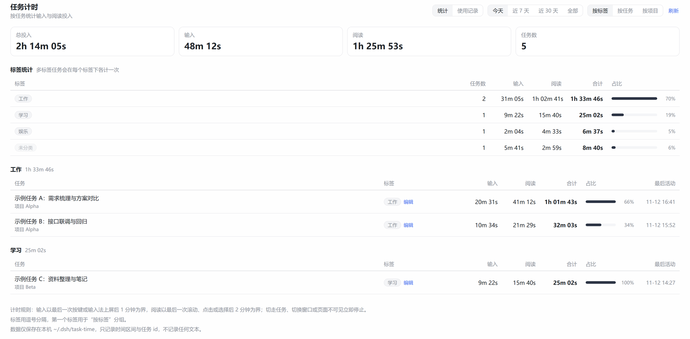
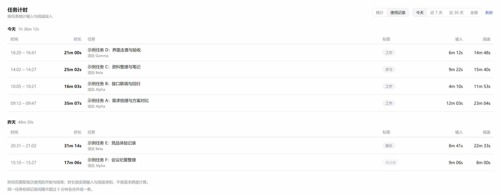

# dsh-task-time

按任务统计**人工投入时间**的 [DeepSeek Harness](https://github.com/deepseek-ai) 插件：分别记录你在每个对话里**打字**和**阅读**了多久，支持空闲自动停表、任务标签与统计面板。

它统计的是人，不是模型：切走任务、切换窗口、长时间无输入都会停止计时；全程不记录任何消息内容。

**语言：中文 ｜ [English](README.en.md)**



*按标签统计、任务明细，可切换按任务 / 按项目分组。*



*使用记录：每次使用的开始与结束时间，时长按实测投入求和。*

## 特性

- **输入计时** —— 从第一次按键到最后一次按键的一段连续时间；消息内部的停顿计入，结尾的空转不计。
- **阅读计时** —— 在输入框外滚轮 / 点击 / 触摸开始，滚动、选中、鼠标移动延长。
- **分阶梯空闲中断** —— 输入 60 秒无操作、阅读 120 秒无活动即停表。
- **噪音过滤** —— 输入不足 5 秒、阅读不足 30 秒的片段直接丢弃。
- **上下文中断** —— 切任务、切面板、失焦、页面隐藏立即结束当前段。
- **草稿也计时** —— 新任务还没创建会话时在输入框里的输入会先挂起，会话创建后自动归入。
- **标签** —— 一个任务多个标签；全局标签库跨任务复用，编辑时点选即可。
- **头部胶囊** —— 当前任务今日累计，实时递增，点击打开统计面板。
- **统计面板** —— 汇总卡、标签统计、按标签 / 任务 / 项目的明细表，以及带开始结束时间的「使用记录」。
- **纯本地** —— 数据在 `$DSH_HOME/task-time`，不联网、不存文本，可随时导出 CSV。

## 安装

1. 克隆仓库到固定位置：

   ```bash
   git clone https://github.com/priatewang/dsh-task-time.git
   ```

2. 在 Harness 的插件管理里安装该目录（`install_bundle`，目标为检出的绝对路径）。它是本地链接安装，之后 `git pull` 只需要重载插件。

3. 刷新页面。侧边栏面板图标里出现时钟图标，会话标题栏出现时间胶囊。

没有构建步骤：`client.js` 是浏览器模块，`index.js` 是普通 ESM 插件。

## 使用

| 位置 | 作用 |
| --- | --- |
| 侧边栏 → 时钟图标 | 打开统计面板 |
| 会话标题栏胶囊 | 当前任务今天的输入 / 阅读累计，点击进面板 |
| 面板 → 统计 | 汇总卡、标签统计、按标签 / 任务 / 项目分组的明细 |
| 面板 → 使用记录 | 每次使用的 `HH:mm – HH:mm`、时长、任务、标签 |
| 面板 → 标签 → 编辑 | 点选已有标签、输入新标签、保存 |

时间范围：今天 / 近 7 天 / 近 30 天 / 全部。

## 配置

```yaml
- id: task-time
  name: dsh-task-time
  config:
    inputIdleMs: 60000    # 输入空闲阈值
    readIdleMs: 120000    # 阅读空闲阈值
```

改配置会重启该插件行。

## 计时规则

| 事件 | 输入 | 阅读 |
| --- | --- | --- |
| 输入框内按键 / 输入法上屏 / 粘贴 | 开始 | — |
| 输入框外滚轮、点击、触摸 | 停在最后一次按键 | 开始 |
| 滚动、鼠标移动、选中文字 | 不中断 | 延长 |
| 光标移动、自动滚屏 | 不中断 | 延长 |
| 点击输入框内 | — | 结束 |
| 切任务 / 切面板 / 失焦 / 页面隐藏 | 结束 | 结束 |
| 空闲阈值 | 60 秒 → 停在最后一次按键 | 120 秒 → 停在最后一次活动 |

因空闲停表时，结束点取**最后一次活动时刻**，所以结尾的空转永远不计入。

## 数据与隐私

```
$DSH_HOME/task-time/
  intervals.jsonl   # { s: 会话id, c: "input"|"read", a: 开始, b: 结束, w: 窗口id }
  tags.json         # { "<会话id>": ["工作", "项目A"] }
```

只存时间戳、会话 id 和标签——不存消息内容、不存按键、不截图。

## HTTP 接口（同源）

| 方法 | 路径 | 用途 |
| --- | --- | --- |
| `POST` | `/task-time/ingest` | `{ intervals: [{ sid, ch, start, end, w }] }` |
| `POST` | `/task-time/tag` | `{ sid, tags: string[] }` |
| `GET` | `/task-time/state?from&to` | 聚合行、标签、标签库 |
| `GET` | `/task-time/log?from&to&gap` | 使用记录（开始 / 结束） |
| `GET` | `/task-time/session?sid&from&to` | 单任务合计（头部胶囊） |
| `GET` | `/task-time/export.csv?from&to` | CSV 导出 |

## 目录结构

```
index.js              宿主：HTTP 路由、JSONL 存储、聚合
client.js             浏览器：状态机 + 统计界面
cordis.patch.yml      插件行定义（行 id `task-time`）
locale/               插件标题与描述（en / zh）
icon.svg              侧边栏图标
docs/REQUIREMENTS.md  完整行为契约（与平台无关）
```

无构建流程。语法检查：`node --check client.js`、`node --check index.js`。

## 许可证

MIT —— 见 [LICENSE](LICENSE)。
